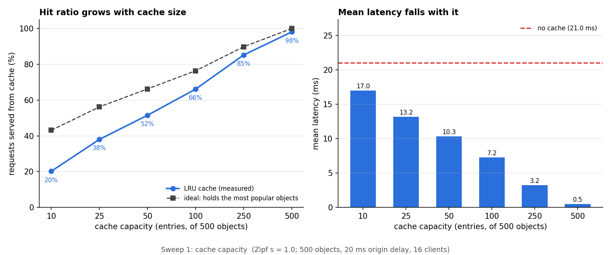
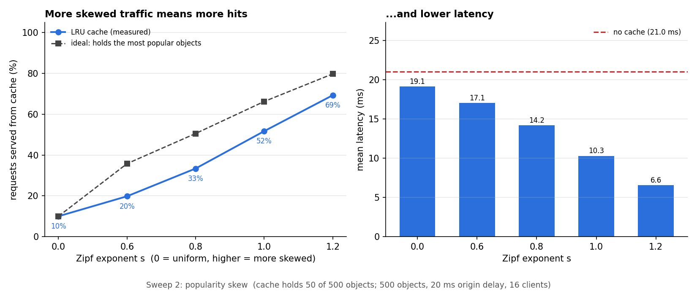
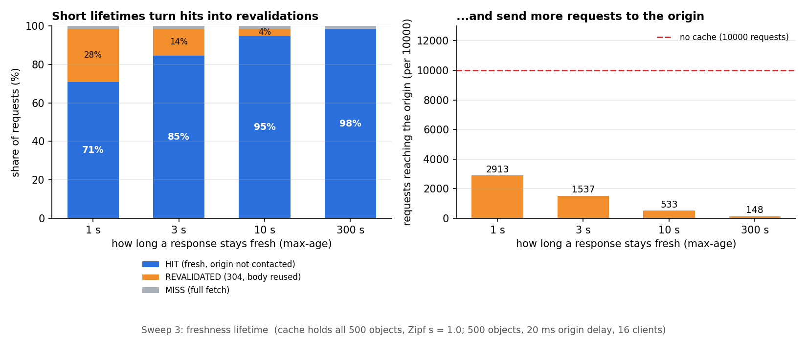

# Forward caching proxy

A forward HTTP proxy with an LRU cache, built on the team's server classes with raw sockets only (no frameworks).
Branch: `proxy-cache`. It adds new files only; the team's `HttpRequest`, `HttpRequestParser`, `HttpResponse`, `RequestReader`, `Server` and `ConnectionHandler` are unchanged.

**What it does**

- Accepts proxy requests (`GET http://host/path HTTP/1.1`), forwards them to the origin and relays the response.
- Caches responses in an LRU cache (O(1) get/put) and obeys `Cache-Control` (`no-store`, `private`, `no-cache`, `max-age`, `s-maxage`), `Expires` and `Last-Modified`.
- Validates stale entries with `ETag` / `Last-Modified` (conditional GET) and answers clients' own conditional requests with `304 Not Modified`.
- Uses persistent connections on both sides (client to proxy, and proxy to origin).

## Run it

Compile everything from the project root:

```
javac -d out src/httpserver/*.java src/httpserver/benchmark/*.java
```

Start the proxy (port 8888, room for 100 cached responses; both arguments are optional):

```
java -cp out httpserver.ProxyServer 8888 100
```

Try it with the team's own server as the origin (in another terminal: `java -cp out httpserver.Server`):

```
curl -i -x http://localhost:8888 http://localhost:8081/index.html
```

On Windows PowerShell use `curl.exe`. Every response carries `X-Cache: HIT`, `REVALIDATED` or `MISS`; cached responses also carry an `Age` header. Press Ctrl+C to print the proxy's hit statistics. Only plain `http://` is supported (see limitations), so point a browser's HTTP proxy setting at it only for HTTP sites.

## How a request is handled

```
client --GET http://host/x--> ProxyHandler
                                 |  RequestReader + HttpRequestParser.parse   (team's classes)
                                 v
                         LruCache lookup (key = normalised URL)
              fresh entry? ----------------------------> HIT: send cached copy, add Age
                    | no
        stale/no-cache entry with ETag or Last-Modified?
              yes --> conditional GET to origin --> 304: REVALIDATED (reuse body, restart freshness)
                    |                           \-> 200: replace entry, send new response (MISS)
              no  --> plain GET to origin (pooled connection) --> MISS
                                 |
                          CachePolicy decides: store, or drop the old copy
```

| File | Role |
|---|---|
| `ProxyServer` | Entry point and accept loop (`main`: port, cache capacity) |
| `ProxyHandler` | One thread per client connection: request loop, cache logic, keep-alive, error responses |
| `ResponseReader` | Reads one origin response (Content-Length, chunked or close-delimited) into a `ProxyResponse` |
| `ProxyResponse` | Immutable parsed response; builds the bytes sent to clients, 304s, and 304 header merges |
| `OriginPool` | Idle keep-alive connections to origins, so a miss does not open a new TCP connection |
| `LruCache` | Thread-safe LRU: `HashMap` + doubly-linked list, O(1) get/put/remove |
| `CacheEntry` | Cached response plus freshness bookkeeping (age, lifetime, validators) |
| `CachePolicy` | The rules: what may be stored, freshness lifetime, matching of client validators |
| `CacheControl`, `HttpDates` | `Cache-Control` parser; HTTP-date parsing and formatting |
| `ProxyStats` | Hit / revalidation / miss counters |
| `TestOrigin` | Configurable origin server for tests and benchmarks (headers chosen by query string) |
| `LruCacheTest`, `CachePolicyTest`, `ProxyCacheTest` | Tests (see below) |
| `benchmark/CacheBenchmark`, `benchmark/ZipfSampler` | Zipfian load generator |

## Caching rules

**Storing a response (shared cache, RFC 7234).** Only `GET` responses with status 200, 203, 204, 300, 301, 404, 405, 410, 414 or 501 are stored. Never stored: `no-store`, `private`, any response with a `Vary` header, responses to requests with an `Authorization` header unless the response says `public`, `s-maxage` or `must-revalidate`, and responses that are stale on arrival and have no validator. Bodies over 1 MB are relayed but not cached. A later response that may not be stored also removes the older copy of that URL.

**Freshness lifetime**, first match wins: `s-maxage`, `max-age`, `Expires` minus `Date`, then a heuristic of 10% of the time since `Last-Modified` (capped at 24 hours). An invalid `Expires` such as `0` means already expired. `no-cache` means the entry must be revalidated on every use.

**Client directives honoured:** `Cache-Control: no-cache` and `Pragma: no-cache` (revalidate or refetch), `max-age=N` (the entry must be younger than N seconds, so `max-age=0` always goes to the origin), `no-store` (do not store the response), `only-if-cached` (`504` if the cache cannot answer).

**Validation.** A stale entry with an `ETag` and/or `Last-Modified` is revalidated with `If-None-Match` / `If-Modified-Since`. On `304` the stored body is reused, headers from the 304 replace the stored ones, and freshness restarts. If the resource changed, the new `200` replaces the entry. An origin `5xx` during revalidation is passed on and the stored copy is kept.

**Client conditionals.** If the client sends `If-None-Match` (weak comparison, lists and `*` supported) or `If-Modified-Since` and our copy matches, the proxy answers `304 Not Modified` itself, without a body. `If-None-Match` takes precedence over `If-Modified-Since`.

**Errors.** Parser errors (`400`, `414`, `431`, `505`) come from the team's `HttpParseException`. Other cases: `405` for methods other than GET/HEAD, `400` for a request target that is not an absolute `http://` URL, `502` when the origin cannot be reached or sends a malformed response, `504` on origin timeouts (5 s to connect, 10 s to read).

**Connections.** Client connections are persistent with the same limits as the team's server (5 s idle timeout, 100 requests per connection, `Connection: close` honoured, no reuse after a request with a body or after an error). Connections to origins are pooled and reused; a pooled connection that the origin has silently closed is retried once on a fresh one.

## Tests

```
java -cp out httpserver.LruCacheTest      # eviction order, recency, concurrency stress
java -cp out httpserver.CachePolicyTest   # Cache-Control parsing, freshness, validators (fixed clock)
java -cp out httpserver.ProxyCacheTest    # 79 end-to-end checks, starts its own origin and proxy
```

`ProxyCacheTest` talks to the proxy over real sockets and checks, request by request, whether the answer was a `HIT`, `REVALIDATED` or `MISS` and how many requests the origin actually saw. It covers every directive above plus keep-alive, pipelining, HEAD, 304 handling, LRU eviction through the proxy, and the origin-connection pool.

## Benchmark

`benchmark/CacheBenchmark` measures what the cache buys under realistic traffic. It runs in one JVM: a test origin that takes 20 ms to answer every request (standing in for a distant server), the proxy, and 16 client threads that request objects drawn from a **Zipf distribution** (a few objects are very popular, most are rarely asked for). 500 objects of 2 KB, 2,000 warm-up requests, then 10,000 measured requests per run. Every run uses the **same request sequence**, and the baseline is clients talking to the origin directly.

```
java -cp out httpserver.benchmark.CacheBenchmark          # about 4 minutes; writes cache_results.csv
java -cp out httpserver.benchmark.CacheBenchmark quick    # smaller, about 1 minute
```

Options (`key=value`): `objects`, `requests`, `warmup`, `concurrency`, `delay`, `size`, `think`, `pause`, `seed`, `out`. Charts are drawn from the CSV with `python docs/make_charts.py cache_results.csv docs` (needs `matplotlib`).

**Baseline without a cache:** mean 21.0 ms, p95 22.1 ms (the origin's 20 ms plus overhead). Raw data: [`docs/cache_results.csv`](docs/cache_results.csv).

### 1. Cache capacity (Zipf s = 1.0)

| capacity (of 500) | hit % | mean ms | p50 ms | p95 ms | requests to origin | latency saving |
|---:|---:|---:|---:|---:|---:|---:|
| 10 | 20.2 | 17.00 | 20.96 | 22.24 | 7979 | 19.1% |
| 25 | 38.0 | 13.17 | 20.62 | 22.13 | 6204 | 37.3% |
| 50 | 51.5 | 10.33 | 0.25 | 22.07 | 4848 | 50.8% |
| 100 | 66.1 | 7.25 | 0.13 | 21.98 | 3392 | 65.5% |
| 250 | 85.2 | 3.21 | 0.10 | 21.22 | 1477 | 84.7% |
| 500 | 98.1 | 0.48 | 0.08 | 0.16 | 186 | 97.7% |



### 2. Popularity skew (cache holds 50 of 500 objects)

| Zipf s | hit % | ideal hit % | mean ms | latency saving |
|---:|---:|---:|---:|---:|
| 0.0 (uniform) | 10.0 | 10.0 | 19.12 | 9.0% |
| 0.6 | 19.8 | 35.8 | 17.05 | 18.9% |
| 0.8 | 33.4 | 50.5 | 14.21 | 32.4% |
| 1.0 | 51.7 | 66.2 | 10.30 | 51.0% |
| 1.2 | 69.3 | 79.8 | 6.58 | 68.7% |



### 3. Freshness lifetime (cache holds all 500 objects, s = 1.0)

| max-age | hit % | revalidated % | miss % | requests to origin | mean ms |
|---:|---:|---:|---:|---:|---:|
| 1 s | 70.9 | 27.7 | 1.5 | 2913 | 6.36 |
| 3 s | 84.6 | 13.9 | 1.5 | 1537 | 3.48 |
| 10 s | 94.7 | 3.9 | 1.5 | 533 | 1.35 |
| 300 s | 98.5 | 0.0 | 1.5 | 148 | 0.52 |

Clients pause 20 ms between requests in this sweep so that the run lasts long enough for entries to expire.



### What the results show

- **Latency has two values.** A hit takes about 0.1 to 0.3 ms; a miss takes about 21 to 22 ms. So the mean is roughly the miss ratio times 21 ms: at capacity 100, 33.9% misses gives 7.1 ms expected and 7.25 ms measured.
- **Diminishing returns, and the gap to an ideal cache.** Going from 10 to 100 entries (10 times) raises the hit ratio from 20% to 66%. An ideal cache that permanently holds the most popular objects would get 43% and 76% there. LRU trails it by 23 points at 10 entries, 10 points at 100 and 4.6 points at 250, because a burst of rarely requested objects can push popular ones out of a small cache. The last 1.9 points at full capacity are the unavoidable first request for each object.
- **Median and tail improve at different times.** The median drops to hit latency once more than half of requests are hits (capacity 50: 0.25 ms, against 20.6 ms at capacity 25). The p95 stays near 22 ms until fewer than 5% of requests miss (capacity 500: 0.16 ms), and p99 stays near 21 ms even then because 1.9% of requests still miss. A cache improves the average and the median long before it improves the tail.
- **The traffic matters as much as the cache size.** With uniform traffic (s = 0) the hit ratio is exactly capacity divided by number of objects (10.0%, so 50 of 500): the cache gives no advantage beyond its size. With strongly skewed traffic (s = 1.2) the same 50-entry cache serves 69% of requests. For s above 0, LRU is 10 to 17 points below the ideal.
- **Freshness lifetime trades origin load for staleness.** With `max-age=300`, 148 requests reach the origin; with `max-age=1` it is 2,913, which is 19.7 times as many, and mean latency rises from 0.52 to 6.36 ms, yet it is still 69.7% below the no-cache baseline. In this setup the test origin delays a `304` as long as a `200`, so a revalidation saves transfer, not time: at 1 s about 2,770 revalidations did not re-send a 2 KB body (about 5.7 MB). Real objects are larger, so the saving would be larger.
- **Connection reuse matters.** The baseline needs 16 TCP connections to the origin for 10,000 requests; through the proxy the origin accepted 0 to 4 new connections per run. An earlier version of the proxy opened one origin connection per cache miss and ran out of ports on Windows (`Address already in use`), which is why `OriginPool` exists.

**Limits of this benchmark:** client, proxy and origin share one machine and its CPU; the 20 ms delay is synthetic; bodies are small (2 KB); the cache starts cold for each run. Absolute numbers will differ on other hardware, but the shapes should not.

## Known limitations

- Plain HTTP only: no `CONNECT` tunnelling for HTTPS. Only `GET` and `HEAD` are supported.
- Responses with a `Vary` header are not cached (the cache keeps one copy per URL).
- Responses are read fully into memory (up to 16 MB, and only bodies up to 1 MB are cached); capacity is counted in entries, not bytes; the cache is lost on restart.
- No request coalescing: if many clients miss on the same URL at once, each request goes to the origin.
- `Range` requests are not served from the cache (a cached hit returns the full 200); `min-fresh`, `max-stale`, `If-Match` and `If-Unmodified-Since` are ignored; field-qualified directives such as `private="x"` are treated as plain `private`; only the standard HTTP-date format is understood.
